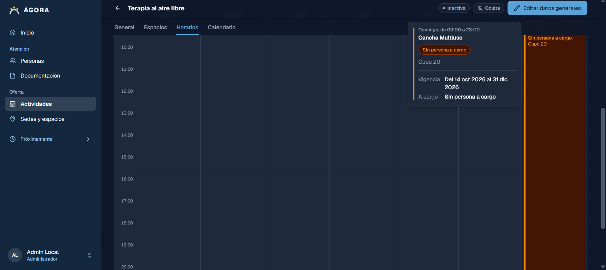
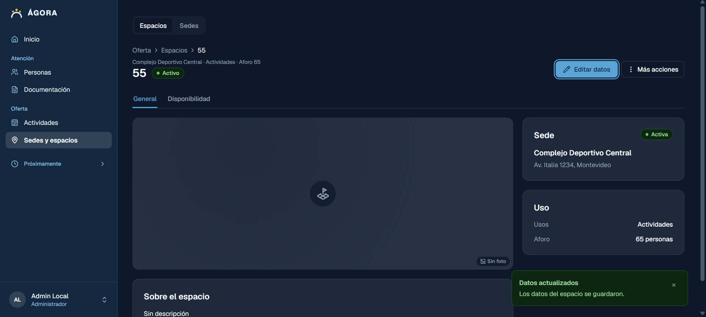
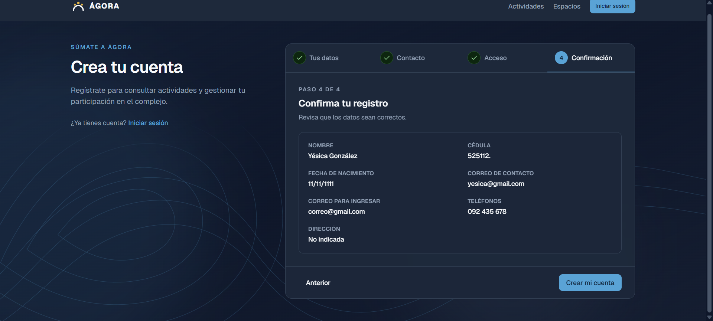

# Auditoría cruzada — ÁGORA: Sistema de Gestión para complejos Deportivos

## 1. Datos de la auditoría

| Campo | Información |
| --- | --- |
| Equipo auditor | SurTech |
| Equipo auditado | 3CodersTeam |
| Sistema | ÁGORA |
| Fecha | 2026-10-14 |
| Ambiente autorizado | Testing |
| Versión / commit | [Versión o hash] |
| Navegador y dispositivo | Edge |
| Alcance | Gestión de usuarios, espacios, actividades, documentos y direcciones |

## 2. Resumen ejecutivo

**Objetivo:** evaluar la usabilidad, las validaciones funcionales, la seguridad de acceso y la consistencia de las operaciones de pago en un ambiente de pruebas.

**Resultado general:** [Síntesis de 3 a 5 líneas con hallazgos principales y alcance efectivamente probado].

| Severidad | Cantidad |
| --- | --- |
| Crítica | [0] |
| Alta | [0] |
| Media | [1] |
| Baja | [2] |

## 3. Funcionalidades revisadas

- [ ]  Inicio de sesión y cierre de sesión.
- [ ]  Crear cuenta
- [ ]  Consultar actividades
- [ ]  Visualizar espacios
- [ ]  Registro de usuarios
- [ ]  Documentación
- [ ]  Registro de actividades
- [ ]  Registro de espacios

## 4. Hallazgos

### H-01 — Creación de una actividad que ocupa todo el día

- **Categoría:** Funcionalidad
- **Severidad sugerida:** Baja
- **Descripción:** Se crea una actividad que ocupa casi todo un día. En realidad, se cuestiona si es algo que debería pasar o no. ¿Una actividad podría tener tantas horas o tener un tope?
- **Precondiciones:** usuario de prueba autenticado
- **Pasos para reproducir:**
    1. Ir a crear actividad
    2. Elegir un horario que ocupe toda la disponibilidad de un día (ejemplo 9 a 23)
    3. Rellenar los demás campos con información válida
    4. Confirmar
- **Resultado esperado:** No está claro
- **Resultado obtenido:** Se crea la actividad con el horario definido
- **Recomendación:** verificar si es algo que puede ocurrir
- **Evidencia:**



### H-02 — Creación de espacio con solo números

- **Categoría:** Funcionalidad
- **Severidad sugerida:** Baja
- **Descripción:** Se permite crear un espacio con números
- **Pasos para reproducir:**
    - Ir a espacios
    - Crear un nuevo espacio
    - Ingresar datos válidos y el nombre en número
- **Resultado esperado:** mensaje comprensible que indique que no ha de ser válido
- **Resultado obtenido:** permite crear
- **Recomendación:** Verificar si es algo que debería ocurrir
- **Evidencia:**



### H-03 — Creación de usuario con datos inválidos de cédula y fecha

- **Categoría:** Funcionalidad
- **Severidad sugerida:** Alta
- **Descripción:** Se permite crear un usuario con datos inválidos de cédula y fecha
- **Pasos para reproducir:**
    - Ir a registrarse
    - Escribir datos incorrectos de cédula (mal formato) y fecha de nacimiento (año imposible)
    - Ingresar el resto de datos bien
    - Crear cuenta
- **Resultado esperado:** mensaje que indica que no ha de ser válido
- **Resultado obtenido:** permite crear
- **Recomendación:** revisar y añadir más validaciones
- **Evidencia:**



## 5. Matriz consolidada

| ID | Categoría | Hallazgo o prueba | Severidad | Estado | Evidencia |
| --- | --- | --- | --- | --- | --- |
| H-01 | Funcional | Creación de una actividad que ocupa todo el día | Baja | Pendiente de verificar | (evidencias/H-01.png)  |
| H-02 | Funcional | Se permite crear un espacio con números | Baja | Pendiente de verificar | (evidencias/H-02.png)  |
| H-03 | Funcional | Creación de usuario con datos inválidos de cédula y fecha | Alta | Prueba propuesta | (evidencias/H-03.png)  |

## 6. Escenarios técnicos ejecutados

| Escenario | Resultado esperado | Resultado obtenido | Evidencia |
| --- | --- | --- | --- |
| Creación de usuario con datos inválidos | Rechazo | Aceptado | (evidencias/H-03.png) |
| Creación de espacio con dato raro| Rechazo | Aceptado | (evidencias/H-02.png)|
| Creación de actividad con horario completo | Rechazo | Aceptado |  (evidencias/H-02.png) |

## 7. Recomendaciones priorizadas

1. **Usuario con datos inválidos de cédula y fecha** Agregar validación adicional.
2. **Creación de espacio con solo números** Verificar que sea posible, añadir las validaciones correspondientes si hace falta.
3. **Creación de una actividad que ocupa todo el día** Verificar que sea posible, corregir si debe tener un límite.

## 8. Validación con el equipo auditado

| Hallazgo | ¿Se pudo reproducir? | Respuesta del equipo | Acción acordada |
| --- | --- | --- | --- |
| H-03 | Sí | Se puede implementar mejoras | Corrección |
| H-02 | Sí | En verificación | Verificar |
| H-01 | Si | Estaría bien revisar si es algo que puede pasar | Correción |

## 9. Publicación y entrega

1. Este documento como `AUDITORIA_AGORA.md`.
2. **Capturas reales anonimizadas** en `evidencias/` y referenciadas así: `!Descripción`.
3. Subir el Markdown y las evidencias al repositorio **GitLab del equipo auditor**.
4. Publicar en el **foro de UTEC**: nombre del equipo auditor, nombre del equipo auditado y enlace al informe en GitLab.
5. Verificar que el enlace sea accesible a docentes y que las imágenes se visualicen correctamente.

### Estructura del repositorio

```
auditoria-cruzada/
├── AUDITORIA_AGORA.md
└── evidencias/
    ├── H-01.png
    ├── H-02.png
    └── H-03.png
```